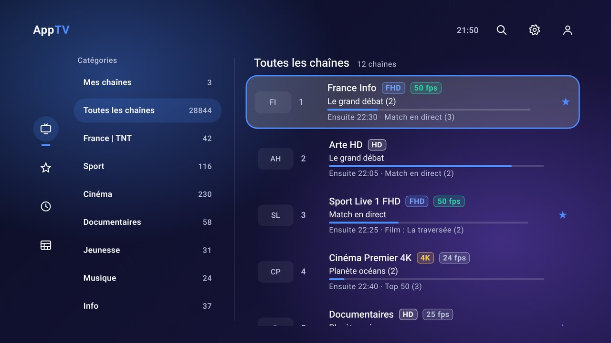
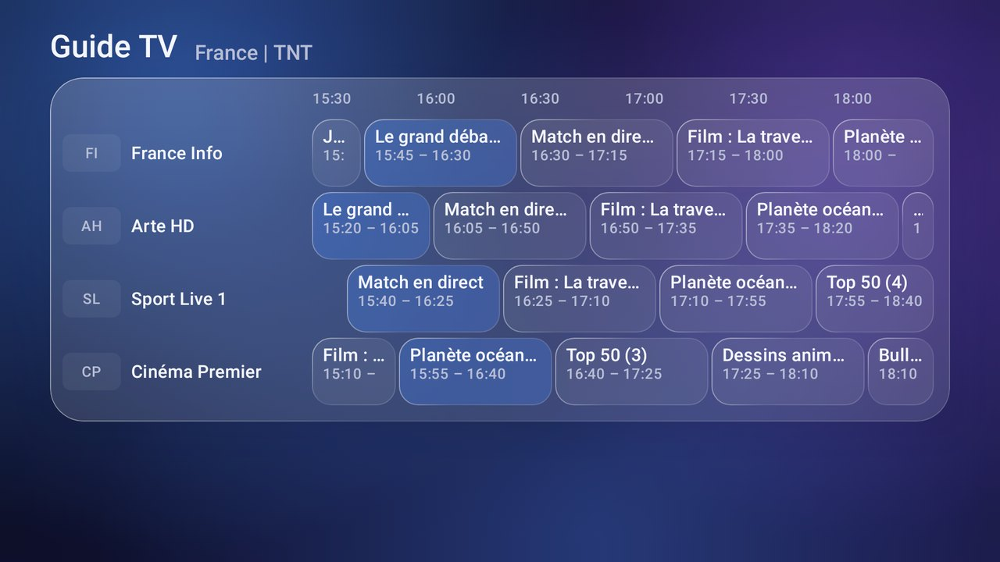
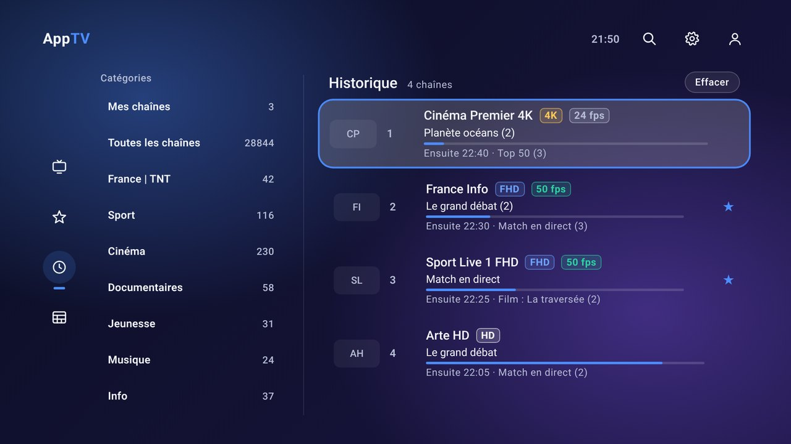
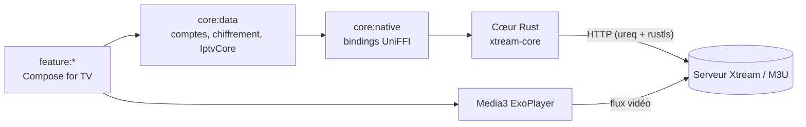

<div align="center">

# 📺 AppTV

**Lecteur IPTV pour Android TV, pensé pour la télécommande et pour l'image.**

Résolution native jusqu'à la 4K, HDR, fréquence d'image d'origine et zapping rapide,
même sur une TV qui a peu de mémoire.

[-3DDC84?logo=android&logoColor=white)](https://developer.android.com/tv)
[](https://developer.android.com/about/versions)
[](https://kotlinlang.org)
[](https://developer.android.com/compose)
[](rust/)
[](https://developer.android.com/media/media3/exoplayer)
<br>
[](#-fonctionnalités)
[](#-fonctionnalités)
[](#)
[](https://github.com/lucaspihery/apptv/commits/main)
[](https://github.com/lucaspihery/apptv/pulls)



</div>

> [!NOTE]
> AppTV ne fournit **aucun contenu**. L'appli lit les flux de votre fournisseur avec vos
> propres identifiants (compte Xtream Codes ou playlist M3U).

## ✨ Fonctionnalités

| | |
|---|---|
| 🔐 **Connexion Xtream** | Identifiants stockés chiffrés (AES-256-GCM, clé Android Keystore non exportable). Jamais de mot de passe ni d'URL de lecture dans les journaux. |
| 🗂️ **Chaînes par catégories** | Listes virtualisées, fluides même avec des dizaines de milliers de chaînes. |
| ▶️ **Lecture plein écran** | Media3 ExoPlayer sur `SurfaceView` : résolution native, HDR, changement de fréquence d'affichage. |
| ⏭️ **Zapping** | Chaîne suivante / précédente à la télécommande, avec bandeau d'information. |
| 🗓️ **Guide TV** | Programme en cours et suivant sur chaque chaîne, avec barre de progression, et grille horaire. |
| ⭐ **Mes chaînes** | Favoris accessibles en un clic depuis le menu. |
| 🔎 **Recherche** | Insensible aux accents. |
| 🕘 **Historique** | Les dernières chaînes regardées. |
| 🏷️ **Pastilles de qualité** | Définition (HD, FHD, 4K) et images par seconde détectées sur le flux. |
| 🎮 **Pensé pour la télécommande** | Tout se pilote au D-pad, focus bien visible, marges d'overscan respectées. |

## 🖼️ Aperçus

<table>
  <tr>
    <td></td>
    <td></td>
  </tr>
  <tr>
    <td align="center"><sub>Guide TV</sub></td>
    <td align="center"><sub>Historique</sub></td>
  </tr>
</table>

<sub>Maquettes de l'interface, avec des chaînes et des programmes fictifs.</sub>

## 🧱 Architecture



- **Cœur Rust** (`rust/crates/xtream-core`) : client Xtream, parseur M3U, catalogue du direct,
  EPG. Exposé à Kotlin par [UniFFI](https://mozilla.github.io/uniffi-rs/), compilé pour
  `arm64-v8a`, `armeabi-v7a` et `x86_64`.
- **Appli Android** : une seule Activity, Jetpack Compose, Hilt, navigation typée.
- **Lecture vidéo** : uniquement Media3 ExoPlayer, Rust ne touche jamais à la vidéo.
- **Interface « verre »** : effets translucides précalculés sur les TV modestes,
  jamais de flou coûteux au-dessus de la vidéo.

Les décisions techniques et les pièges connus sont détaillés dans [CLAUDE.md](CLAUDE.md).

## 🗺️ Feuille de route

| Jalon | Contenu | État |
|:---:|---|:---:|
| 1 | Squelette, navigation D-pad, connexion Xtream / M3U, mot de passe chiffré | ✅ |
| 2 | TV en direct : catégories, grille, favoris, recherche sans accents | ✅ |
| 3 | Lecteur plein écran, zapping, bandeau technique, reprise au direct | ✅ |
| 4 | EPG : en cours / suivant, grille horaire, cache SQLite | 🚧 |
| 5 | Mini-lecteur dans la liste | ⏳ |
| 6 | VOD, séries, multi-comptes, réglages | ⏳ |
| 7 | Performance (Macrobenchmark, Baseline Profile), finitions | ⏳ |

✅ fait · 🚧 en cours · ⏳ à venir

## 🛠️ Compiler

Prérequis : JDK 21, SDK Android (plateforme 36), NDK, [rustup](https://rustup.rs) et
cargo-ndk 4 (`cargo install cargo-ndk --locked`). La version de Rust et les cibles Android
sont installées automatiquement par `rust/rust-toolchain.toml`.

```bash
./gradlew assembleDebug                              # 3 ABI : arm64-v8a, armeabi-v7a, x86_64
./gradlew assembleDebug -Papptv.abis=armeabi-v7a     # plus rapide pour une TV 32 bits
./gradlew assembleDebug -Papptv.abis=x86_64          # émulateur
```

L'APK se trouve dans `app/build/outputs/apk/debug/`.

### Tests

```bash
cd rust && cargo fmt --all && cargo clippy --all-targets -- -D warnings && cargo test
./gradlew testDebugUnitTest lintDebug
```

## 📲 Installer sur la TV et diagnostiquer avec ADB

### 1. Activer le débogage sur la TV

1. **Paramètres → Système → À propos** (sur TCL / Google TV : *Paramètres → Système →
   À propos*), puis appuyer **7 fois** sur **Build Android TV OS** (ou « Version ») jusqu'au
   message « Vous êtes développeur ».
2. **Paramètres → Système → Options pour les développeurs** : activer **Débogage USB** et,
   s'il existe, **Débogage réseau / ADB sans fil**.
3. Noter l'adresse IP de la TV : **Paramètres → Réseau et Internet → (votre réseau)**.

### 2. Se connecter depuis l'ordinateur (même réseau)

```bash
adb connect 192.168.1.50:5555      # IP de la TV ; accepter la demande d'autorisation sur la TV
adb devices                        # la TV doit apparaître comme « device »
```

Sur Android 11+, si la TV propose l'**ADB sans fil avec appairage**, utiliser
`adb pair IP:PORT` avec le code affiché, puis `adb connect IP:PORT`.

### 3. Installer et lancer

```bash
adb install -r app/build/outputs/apk/debug/app-debug.apk
adb shell am start -n io.github.lucaspihery.apptv/.app.MainActivity
adb shell getprop ro.product.cpu.abilist   # ABI supportées (armeabi-v7a seul = TV 32 bits)
```

### 4. Récupérer un logcat

```bash
adb logcat -c                                   # vider le journal
# … reproduire le problème sur la TV …
adb logcat -d -v threadtime > logcat.txt        # tout le journal
adb logcat -d -v threadtime --pid=$(adb shell pidof -s io.github.lucaspihery.apptv) > appli.txt
```

L'appli ne journalise jamais les mots de passe ni les URL de lecture. Avant de partager un
logcat complet, vérifiez quand même qu'il ne contient pas d'autres informations personnelles.

### 5. Problèmes d'affichage vidéo (son sans image, écran noir, saccades)

```bash
# Décodeurs et sorties vidéo / surfaces
adb logcat -d -v threadtime | grep -iE "MediaCodec|ExoPlayer|SurfaceFlinger|BufferQueue|HWC|hdr|omx|c2\." > video.txt

# Couches à l'écran pendant la lecture : la SurfaceView vidéo doit être visible,
# sans couche opaque au-dessus (piège TCL : fenêtre opaque = son sans image)
adb shell dumpsys SurfaceFlinger > surfaceflinger.txt

# Capacités HDR et modes d'affichage (fréquences) de la TV
adb shell dumpsys display | grep -iE "hdr|mode|refresh|fps" > display.txt

# Décodeurs disponibles (4K, HEVC, HDR10, Dolby Vision…)
adb shell dumpsys media.player > media.txt

# Fluidité de l'interface (images manquées dans les listes)
adb shell dumpsys gfxinfo io.github.lucaspihery.apptv reset
# … faire défiler une liste quelques secondes …
adb shell dumpsys gfxinfo io.github.lucaspihery.apptv > gfxinfo.txt

# Capture d'écran
adb exec-out screencap -p > ecran.png
```

Joindre ces fichiers à un rapport de bug, avec le modèle de la TV et le type de flux
(HLS ou MPEG-TS, résolution annoncée).
